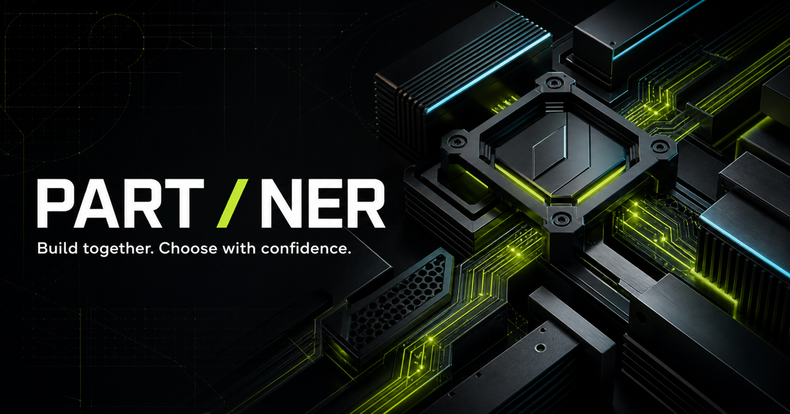

# PART / NER

**Build together. Choose with confidence.**

A PC-parts storefront where a person and their AI assistant work on the **same live build**. The assistant can display a shortlist, explain compatibility problems, and stage changes through WebMCP. The person can inspect the actual products, choose parts, and approve a preview in the page.

[**Try the live demo**](https://part-ner-pc-builder.hiroki-matsue.chatgpt.site/) · [The WebMCP Challenge](https://webmcp.devpost.com/) · [Source code](https://github.com/Matsue/part-ner-pc-builder)

The demo is publicly accessible on **ChatGPT Sites**. No site login, credentials, purchase, or application API key is required.



> This is a fictional PC-building demo, not a retailer or hardware buying guide. All products, games, prices, and performance estimates are invented. Product images are AI-generated concepts. Prices are USD and exclude tax and shipping.

## Why this is a good fit for WebMCP

Choosing PC parts involves dependent decisions: a graphics card must fit the case, a processor must match the motherboard socket, and every choice affects the remaining budget. A recommendation in a separate chat can lose that context as soon as the user changes a part.

PART / NER gives the assistant structured access to the same catalog, compatibility rules, and state that power the interface. It turns a conversational recommendation into something the user can **see, compare, and act on in the storefront**, without copying a shopping list between chat and the page.

- **Shared context:** human clicks and agent tool calls read and update one build store within the current page.
- **Visible recommendations:** one `recommend_products` call ranks and displays up to three candidates, without selecting a part.
- **App-owned facts:** prices, projected totals, compatibility, and demo FPS estimates come from application logic, not generated claims.
- **Human-approved changes:** an agent can propose several replacements in one before/after preview, but cannot apply them. The person must click **Approve & apply preview** in the page; missing, stale, or already-applied previews are rejected.
- **Context-sensitive capabilities:** `resolve_build_issues` is registered only while the current build has a compatibility error.

The intended audience is people comparing unfamiliar components with an assistant. This prototype explores that collaborative workflow with a small, reproducible catalog rather than claiming real-world hardware coverage.

## Try it as a judge

### Browser setup

1. Open the [live demo](https://part-ner-pc-builder.hiroki-matsue.chatgpt.site/) in a WebMCP-capable browser/agent client. The [challenge instructions](https://webmcp.devpost.com/) describe ChatGPT's in-app browser and Chrome with `chrome://flags/#enable-webmcp-testing` enabled.
2. Keep the app open as the active page available to the assistant. Use the host client's conversation to send the prompts below; the storefront does not contain its own chatbot.
3. To inspect registration, open the [debug view](https://part-ner-pc-builder.hiroki-matsue.chatgpt.site/?debug=1). It shows seven base tools and an additional repair tool when a compatibility error exists. Close the panel for the normal demo.

The ordinary storefront still works without WebMCP. Browsing the public site requires no login; using an external assistant may require that assistant's own account and supported environment.

### Suggested walkthrough

Start with a fresh page. It starts with a $2,000 budget and **no color preference**. **Reset build** clears selected parts, previews, and inferred preferences, but preserves explicitly changed goals; reload the page to repeat this exact scenario.

**1. Make a human choice.** Select **AeroFrame N1 White** in the Case category.

**2. Ask for GPU options.**

> Help me build a gaming PC under $2,000. I want to play Astral Frontier at 1440p High at 60 FPS or better, and Neon Arena at 144 FPS or better. Start with three GPU options.

Expected: the Graphics card category opens with **VectorArc G88 16GB** ($828, **BEST BALANCE**), **PixelForge V70 White 12GB** ($898, **AESTHETICS**), and **VectorArc G96 16GB** ($998, **PERFORMANCE**). The case alone does not establish a color preference. G88 is cheaper and has more VRAM and higher estimated FPS than V70 White; the white GPU still meets both targets and is 16 mm shorter. Trade-offs compare these concrete differences, not just the remaining budget.

Choose **PixelForge V70 White 12GB** yourself for its appearance, despite G88's value advantage. Only now do the matching manual case/GPU selections produce a **tentative white-style preference**, shown as inferred in the header and returned to the agent with the supporting product IDs. Stated goals are not silently rewritten. Agent-proposed parts applied through an approved batch preview do not create this inference.

**3. Continue naturally.**

> Which CPU would you recommend?

Expected: three CPU candidates appear in the page, taking the current build into account. With the case and GPU above, **CorePeak A6-65** ranks first. No CPU is selected automatically. The agent can acknowledge that the manual choices suggest an aesthetic preference; later motherboard/PSU suggestions favor matching colors when compatible and within budget. An explicit color request—or “color does not matter”—overrides the inference. Natural-language acknowledgment still depends on the host agent.

**4. Stage a multi-part change.**

Select **CorePeak A6-65** yourself from the CPU candidates. Then ask:

> Finish the rest of the build. Keep the white theme and stay under $2000.

Expected: **Your build** shows a preview adding **FrostBoard A5M Ice** and **VoltNest 750 Snow**, with a projected total of **$1,970.00**. The selected case, GPU, and CPU stay unchanged; the motherboard and PSU remain unselected until you click **Approve & apply preview**. The assistant cannot apply its own proposal, even if the request says “finish.” On a narrow screen, use **Review preview** in the sticky budget summary to jump to the panel.

**5. Explore a conflict.** Select **Orion C6-125** manually in the Processor category. It has a different socket from the selected motherboard. Then ask:

> Explain the compatibility problem and compare the repair options. Preview the fix that keeps my motherboard. Don't apply it yet.

Expected: the assistant can use the newly available `resolve_build_issues` tool, then stage the chosen repair. The page exposes the problem instead of silently replacing parts.

**Optional stale-state check:** while a preview is open, select a different part. The preview becomes out of date and cannot be applied. Ask for a fresh preview based on the latest build.

### Reproducible reference build

| Category | Product | Product ID | Demo price |
| --- | --- | --- | ---: |
| Case | AeroFrame N1 White | `case-01` | $188.00 |
| GPU | PixelForge V70 White 12GB | `gpu-02` | $898.00 |
| CPU | CorePeak A6-65 | `cpu-01` | $448.00 |
| Motherboard | FrostBoard A5M Ice | `mb-02` | $278.00 |
| Power supply | VoltNest 750 Snow | `psu-04` | $158.00 |
| **Total** | **Compatible; all colored parts white; $30 remaining** | | **$1,970.00** |

With the default goals, the demo calculates **70–78 FPS** for Astral Frontier and **186–206 FPS** for Neon Arena. These are fictional model outputs, not measured benchmarks. This total covers only the five supported categories, not a complete real PC.

### If the assistant replies only in chat

Tool selection belongs to the host agent; a natural-language question cannot guarantee a tool call. Ask:

> Use `recommend_products` with `category: "cpu"` to display three CPU options on this page. Do not select or apply anything.

If no cards appear, check `?debug=1` for **registered**, not just **declared**, tools. A chat interface or browser extension must actually support discovering and calling this page's WebMCP tools; simply pasting its URL into a conversation is not equivalent. In the page's developer console, `typeof document.modelContext?.registerTool` should return `"function"`. Reload the page after enabling support or changing clients.

## WebMCP implementation

The app uses the imperative **`document.modelContext.registerTool`** API. Tool definitions, JSON input schemas, annotations, and execution callbacks are in [`lib/webmcp/tools.ts`](lib/webmcp/tools.ts). React lifecycle registration is in [`lib/webmcp/use-webmcp.ts`](lib/webmcp/use-webmcp.ts).

Registration follows this pattern; the implementation also tracks successes/failures and registers the repair tool conditionally:

```ts
const context = document.modelContext;
if (context?.registerTool) {
  const lifecycle = new AbortController();
  for (const tool of createWebMcpTools(buildStore)) {
    await context.registerTool(tool, { signal: lifecycle.signal });
  }
  // React effect cleanup calls lifecycle.abort().
}
```

| Tool | Purpose | Effect on the app |
| --- | --- | --- |
| `get_current_build` | Read selected parts, goals, totals, issues, visible recommendations, and pending preview status | Read-only |
| `set_build_goal` | Set USD budget, theme, priority, and game targets | Updates goals and build version; does not select parts |
| `recommend_products` | Rank and display 1–3 options for a category; defaults to 3 | Updates category and recommendation cards only |
| `find_products` | Read/filter catalog facts and projected outcomes | Read-only; does not display cards |
| `show_product_candidates` | Display a custom shortlist with agent-written reasons | Updates category and cards, not selected parts |
| `preview_build_changes` | Stage additions, replacements, or removals against a build version | Creates a preview and returns an instruction to await in-page approval; never applies |
| `resolve_build_issues` | Return repair plans for a current compatibility error | Read-only; registered only while an error exists |

Supported categories are `case`, `gpu`, `cpu`, `motherboard`, and `psu`.

### State and approval boundaries

Both the React UI and WebMCP callbacks use the same Zustand store. Human selections and agent mutations increment a shared version. Custom shortlists and previews must reference the current version; applying a stale preview raises `PREVIEW_EXPIRED` instead of overwriting newer choices.

**There is no `apply_build_changes` WebMCP tool.** Registering it only while a preview exists would still let an agent create and immediately apply its own proposal. Instead, WebMCP stops at staging; only the in-page **Approve & apply preview** button invokes the human apply action. The store rejects agent apply calls (including legacy callbacks holding a valid preview ID) and agent direct selections. A lint rule also prohibits WebMCP modules from calling selection, apply, reset, or raw state-write methods. Goals and recommendation cards can still be updated through their dedicated tools; they do not select parts.

Approval applies exactly the current preview once. Dismissal, replacement, reset, or a newer build/goal version invalidates the old proposal. Conversational “yes” is intentionally insufficient: the user must approve in the page. This is an application-level WebMCP boundary, not protection against arbitrary scripts or a separate browser-control agent clicking UI buttons. This demo has no checkout or other irreversible transaction.

## Architecture

```text
Human actions in React UI       Agent calls through WebMCP
            \                         /
             Shared in-page Zustand store
                       |
        Catalog + deterministic domain functions
        compatibility / goals / recommendation ranking
                       |
         Catalog cards, shortlist, build, preview
```

- **UI:** React 19, TypeScript, Tailwind CSS, a shadcn-derived Base UI button, Lucide icons.
- **Build:** Vinext on Vite; static export via `output: 'export'`.
- **Hosting:** public ChatGPT Sites deployment; configuration in [`.openai/hosting.json`](.openai/hosting.json).
- **Data:** 30 fictional products, six in each category, with local WebP imagery. No database or live retailer integration.
- **AI at runtime:** the browser's external assistant interprets requests and chooses tools. The app itself makes no model API calls; default ranking and numerical facts are deterministic. Custom shortlist explanations may be supplied by the agent.

Source map:

- [`app/page.tsx`](app/page.tsx): explicitly static route wrapping the browser-side builder.
- [`app/pc-builder.tsx`](app/pc-builder.tsx): catalog, recommendations, build summary, previews, debug panel.
- [`lib/store/build-store.ts`](lib/store/build-store.ts): shared state and versioned mutations.
- [`lib/domain/`](lib/domain/): catalog/types, compatibility rules, budget/FPS calculations, ranking.
- [`lib/webmcp/`](lib/webmcp/): tool contracts and browser registration.
- [`lib/accessibility/`](lib/accessibility/): concise build-update announcements.
- [`tests/`](tests/): domain, state, WebMCP, localization, imagery, and accessibility regression tests.
- [`docs/imagery.md`](docs/imagery.md): generated-image provenance and fictional USD pricing.

## Run locally

Use **Node.js 24** and npm. The project declares Node.js `>=22.13.0`; Node 24 was used for verification and runs the TypeScript test files directly.

```bash
git clone https://github.com/Matsue/part-ner-pc-builder.git
cd part-ner-pc-builder
npm ci
npm run dev
```

Open the local URL printed by the server, normally `http://localhost:3000`. No `.env` file, model API key, database, or deployment credentials are needed to run the app locally. The committed `package-lock.json` pins the dependency tree; use `npm ci` for a reproducible install.

To build and serve the static output:

```bash
npm run build
npm start
```

Open the URL printed by the preview server, normally `http://127.0.0.1:4173`. This serves the static export in `dist/client`; it is a local preview, not a production hosting service. Development and builds do not require Wrangler, Miniflare, or the Cloudflare Vite plugin.

The checked-in Sites project configuration identifies the original deployment. Running locally does not grant deployment access; publishing your own copy requires your own hosting setup.

## Verification

```bash
npm test
npm run audit
npm run lint:accessibility
npx --no-install oxlint app lib scripts
npx --no-install tsc --noEmit --incremental false
```

All **39 automated tests** passed on September 3, 2026. Coverage includes compatibility errors and power warnings, USD totals, recommendation display without part selection, value-first GPU ranking, tentative color preferences with manual-selection provenance and explicit overrides, factual trade-offs, read-only lookup behavior, current-motherboard ranking, invalid recommendation input, the finish-build approval flow, blocked agent application, single-use and invalidated previews, image/alt-text coverage, update announcements, bottom-right debug-panel placement, and static-preview configuration.

The scoped application lint command above passes. The repository-wide `npm run lint` also checks test typing and currently reports pre-existing issues; it is not a clean full-repository gate.

Dependency maintenance uses exact direct versions and a committed lockfile. `npm run audit` checks runtime and development dependencies, failing even on low-severity findings. Unused UI scaffolding and Cloudflare development/deployment dependencies have been removed; the public site remains a static export hosted on ChatGPT Sites.

`ipaddr.js` is kept as a build dependency because Vinext's image shim externalizes it during Node-based static rendering. `npm run build` also verifies that the home page and its local assets were actually emitted, catching silently skipped routes.

Browser checks during development included:

- Real WebMCP discovery and invocation in the Codex in-app browser; see the precise scope in [`docs/webmcp-verification.md`](docs/webmcp-verification.md).
- CPU candidates, preview approval via keyboard, conflict feedback, and stale-preview handling in the local UI.
- 320px-wide reflow, enlarged root text at 200%, and increased text spacing.
- Lighthouse accessibility scores of 100 on the checked desktop and narrow-screen states, including candidate/preview/error states. This is not a WCAG conformance certification; a dedicated screen-reader session has not been performed.

The public deployment was also checked without authentication. Natural-language routing remains host-dependent; manually invoking a tool is not evidence that every client or prompt will choose it automatically. The automated suite does not require a browser and is not an end-to-end host-agent test.

## Built with AI assistance

Codex helped implement and iterate on the interface, shared-state logic, WebMCP contracts, regression tests, USD/English localization, and accessibility improvements. One important iteration combined ranking and on-page display into `recommend_products`, after a read-only lookup could leave the user with a chat answer but no visible shortlist.

AI image generation produced the fictional component renders and project artwork. The component briefs, mappings, and provenance are documented in [`docs/imagery/`](docs/imagery/) and [`docs/imagery.md`](docs/imagery.md). These images illustrate the experience; catalog specifications remain authoritative.

## Known limitations

- **Not a complete PC configurator:** RAM, storage, CPU cooling, operating systems, peripherals, real inventory, and purchases are outside this demo.
- **Simplified performance model:** FPS uses a fictional per-GPU/per-game table, resolution multipliers, and a ±5% range. CPU scores influence performance-priority ranking but do not change displayed FPS. Preset labels are stored/displayed but do not independently adjust the FPS calculation.
- **Limited compatibility model:** checks cover CPU socket, motherboard/case form factor, GPU clearance, PSU form factor, and the GPU's recommended PSU wattage—not real-world electrical, thermal, or BIOS validation.
- **Partial-build totals:** candidate totals include selected parts plus that candidate. Unselected categories still require budget. Recommendations expose alternatives that may miss some goals.
- **Page-local state:** refreshing resets the build. “Shared” means the human and agent in the same page, not cross-device collaboration or persistent accounts.
- **Experimental browser API:** this version targets `document.modelContext`; environments exposing a different WebMCP API may require adaptation. Unsupported browsers retain manual browsing but cannot invoke these tools.
- **In-page approval only:** conversational approval cannot apply a proposal. The user must review and approve it in the page; WebMCP has no apply action.

## License and submission materials

This project is licensed under the **[MIT License](LICENSE)**. Third-party dependencies retain their respective licenses.

This README provides the project explanation and testing instructions. The separate public demo video has not been linked here yet; the challenge requests a public YouTube demo under three minutes with audio. Updating this repository does not submit a Devpost entry.
